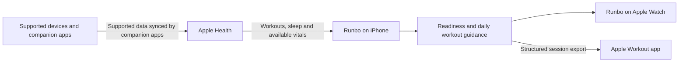

# Architecture and trade-offs

This is a conceptual map of publicly described product boundaries, not a code-level or deployment diagram. It deliberately omits unpublished implementation details.

## Design implications

These are engineering considerations inferred from the public product behavior, not claims about internal algorithms or measured results.

| Product choice | Benefit | Constraint to handle |
| --- | --- | --- |
| Apple Health as the input boundary | One platform integration can receive supported data from multiple sources. | Missing fields, delayed sync and different source detail can affect guidance. This is not a direct Garmin, WHOOP or Oura integration. |
| Daily guidance instead of a rigid calendar | The next session can respond to recent activity and recovery. | Explanations should distinguish estimates from facts and make uncertainty understandable. |
| Export into Apple's Workout app | A recommendation becomes an executable session on the wrist. | Workout structure, targets and platform capabilities must remain consistent with the displayed suggestion. |
| Watch access without a nearby phone | Supports checking guidance during a run. | Data freshness and limited screen space matter; this diagram does not assert a particular sync protocol. |

## Optional coaching is a separate boundary

The product website describes Ask Coach using supported Apple Intelligence hardware or an optional online mode with consent. It describes separate handling for questions/context and the Health-derived values needed for personal replies. This should not be summarized as “all data always stays on-device.” See the live [product FAQ](https://runbo.app/) and [privacy policy](https://runbo.app/privacy) for the current disclosure; this diagram covers the core training flow only.

## Useful engineering discussion topics

- How to represent incomplete, late or conflicting Health inputs.
- How to keep a recommendation, its explanation and the exported workout consistent.
- How to test calendar boundaries and changes in recent training history.
- How to show the freshness of watch data and make optional online processing understandable.

These are discussion topics, not a claim that a specific internal test suite or architecture has been published.
